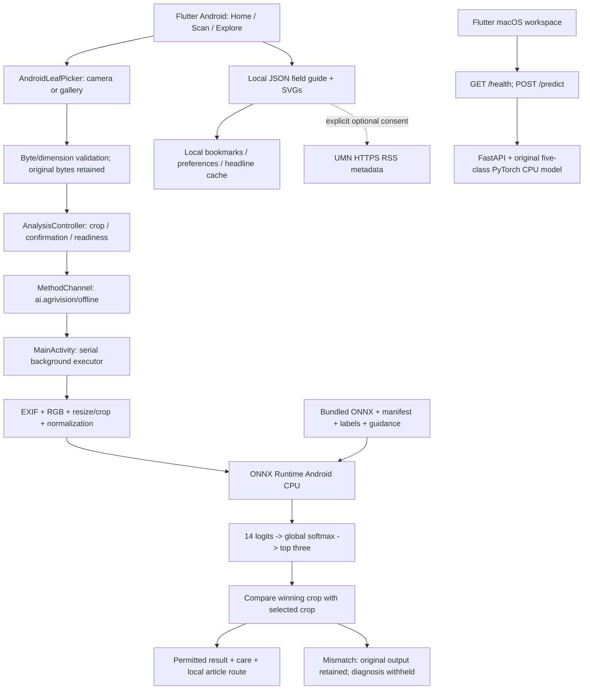

# AgriVision AI — Final Report Evidence

**Evidence extraction date:** 15 October 2026, Africa/Lusaka (CAT, UTC+02:00).  
**User-stated submission deadline:** 15 October 2026, 18:00 CAT.  
**Purpose:** a technical evidence dossier for preparing the academic report; this is not the final academic report.  
**Repository inspected:** `/Users/frankmeyo/Downloads/AgriVision AI`.  
**Current branch:** `codex/phase5-2-field-guide`; current Git HEAD is `24bfc2b` (Phase 1 foundation). Later working source remains largely uncommitted. Do not describe that commit as the complete current release.

## Evidence conventions and authority

- **Artifact:** a value or result read from an existing checkpoint, JSON, saved log, APK, screenshot or source file. Historical test outcomes are not new test executions.
- **Source implementation:** behavior supported by inspected production code; this does not alone establish an exhaustive device test.
- **Derived in this extraction:** a transparent calculation/check performed on saved artifacts, without retraining, conversion, new predictions or evaluation-image downloads.
- **Historical verification:** a prior phase's documented execution. Phase/device/model scope is identified explicitly.
- **User report:** behavior supplied by the user, not automatically an independently instrumented result.
- **Planned / missing:** not an implemented or verified capability.

For the deployed Android classifier, prioritize the returned Phase 4 run, the bundled ONNX/manifest, final APK and Phase 5.2 verification evidence. `models/evaluation.json` belongs to the older five-class desktop model. `docs/architecture.md` describes Phase 1; `docs/PHASE4_COLAB.md` and `docs/phase4_preparation_verification.json` explicitly describe the preparation stage before the later trained ZIP returned. Their earlier “not trained yet” statements do not supersede the later actual artifacts. Historical Phase 3 installation/verification documents concern a tomato-only APK and emulator tests, not the current fourteen-class physical-device release.

During this extraction, saved predictions were cross-checked against the test manifest/confusion matrix, recorded split identities were checked for overlap, checkpoint metadata was read with `torch.load(..., weights_only=True)`, and local hashes/APK model bytes were compared. No application, model, training or deployment artifact was changed; no test suite, training, conversion, build, device operation or Git push was run for this extraction. The only new repository deliverable is this Markdown document.

## 1. Project identity and objectives

### 1.1 Name and problem addressed

**Brand:** AgriVision AI. **Repository subtitle:** “Intelligent Crop Disease Detection and Management System.” The repository does not establish a separate officially registered academic project title, student number, supervisor, institution or marking outcome; those must come from the author/institution.

The implemented problem is accessible leaf-image assessment and agricultural education where a farmer or student may lack reliable connectivity or immediate specialist access. The application compares a leaf photograph against a limited set of learned crop-condition classes, displays ranked model scores, and provides sourced educational descriptions and management/prevention guidance. This is decision support, not laboratory diagnosis, a measured yield-improvement intervention or a substitute for professional confirmation. No project-specific crop-loss, farmer-income, adoption or economic-impact statistic was measured.

### 1.2 Original and expanded scope

| Stage | Implemented scope and evidence boundary |
|---|---|
| Phase 1 foundation | Shared PyTorch architecture/preprocessing, reproducible dataset/training/evaluation code, FastAPI and a minimal Flutter macOS scaffold. Initial tests included synthetic pipeline mechanics; they were not disease-performance evidence. |
| Phase 2 desktop | Working macOS image selection, HTTP readiness/predictions and sourced care through FastAPI; five tomato classes. |
| Phase 3 Android | Standalone, native on-device ONNX inference for the five tomato classes; gallery/camera integration and packaged local guidance. |
| Phase 4 multi-crop | Actual fourteen-class MobileNetV3-Small trained in Colab; verified ONNX conversion and four-crop Android deployment, with manual crop selection and mismatch withholding. The preserved macOS/FastAPI path remains five-class. |
| Phase 5 Evergreen | Home / Scan / Explore presentation, original illustrations, light/dark themes, mobile layouts and qualified results. Existing classifier retained. |
| Phase 5.2 Field Guide | Six educational crop profiles, sixteen total local entries, search/bookmarks/related reading and successful-scan article routes; optional cached extension headlines. No new classifier or trained cabbage/collard classes. |

The user states the application has already been presented. The repository supplies technical test/build/device evidence, not attendance records, lecturer assessment, formal usability-study scores or presentation feedback.

**Evidence:** [README.md](</Users/frankmeyo/Downloads/AgriVision AI/README.md>); [docs/verification.md](</Users/frankmeyo/Downloads/AgriVision AI/docs/verification.md>); [docs/frontend-completion.md](</Users/frankmeyo/Downloads/AgriVision AI/docs/frontend-completion.md>); [docs/PHASE3_COMPLETION.md](</Users/frankmeyo/Downloads/AgriVision AI/docs/PHASE3_COMPLETION.md>); [docs/PHASE5_EVERGREEN.md](</Users/frankmeyo/Downloads/AgriVision AI/docs/PHASE5_EVERGREEN.md>); [docs/PHASE5_2_FIELD_GUIDE.md](</Users/frankmeyo/Downloads/AgriVision AI/docs/PHASE5_2_FIELD_GUIDE.md>).

## 2. System architecture

### 2.1 Current components

The frontend uses Flutter/Dart with a small service/controller/presentation separation, rather than an additional state-management framework. `AgriVisionApp` owns an `AnalysisController` (`ChangeNotifier`), chooses the actual platform API and picker, and starts readiness/image recovery. `ListenableBuilder`-based presentation listens to controller state. Shared typed models validate image metadata, finite/sorted prediction scores and known class order.

On Android, `OfflineAgriVisionApi` implements the shared `AgriVisionApi` interface through a native `MethodChannel`, not HTTP. On macOS, `HttpAgriVisionApi` uses FastAPI. Test constructor injection exists, but production defaults construct the actual native or HTTP service. Tests' fixture scores are not production predictions.

The following schematic is **derived from inspected source for this evidence document**; it is not a newly measured trace or an existing exported architecture image:



### 2.2 Android native architecture

- Channel name: `ai.agrivision/offline`; methods: `health` and `predict`; prediction argument: original image `bytes`.
- `MainActivity` handles work using `Executors.newSingleThreadExecutor()`, returning channel responses through the Android main-thread handler. Inference does not run on Flutter's rendering thread.
- `OfflineClassifier` maintains one reusable ONNX Runtime session. Loading verifies manifest version, preprocessing values, exact ordered labels, guidance presence, ONNX SHA-256 and expected tensor shapes.
- Session settings: **2 intra-op threads**, **1 inter-op thread**, `ALL_OPT` graph optimization. This implementation uses CPU inference; NNAPI, GPU, cloud acceleration and quantization are not implemented.
- `LeafPreprocessor` owns RGB geometry, all eight EXIF orientations, Pillow-compatible bilinear filtering and float32 NCHW normalization.
- Float logits are converted to a stable global softmax in Kotlin using a maximum-logit subtraction and double-precision exponent/sum calculations. Ties in ranked indices are resolved by class index. The highest three scores are returned with local guidance and a confidence note.
- Tensors/results/session options use scoped resource closing. The session is closed during Flutter-engine cleanup. Explicit R8/ProGuard keep rules preserve ONNX JNI classes; historical release shrinking exposed why a debug-only test is insufficient.

### 2.3 MobileNetV3-Small used by the project

The implementation calls `torchvision.models.mobilenet_v3_small`, using ImageNet `IMAGENET1K_V1` initialization for Phase 4 training and replacing only the final output linear layer for fourteen classes. The fourteen-class run starts from ImageNet; it does **not** load the old five-class checkpoint as its initialization.

The inspected torchvision 0.23 implementation comprises a 3×3 stride-2 convolutional stem, eleven inverted-residual blocks with depthwise convolutions and pointwise expansion/projection, selected squeeze-and-excitation blocks, ReLU/Hard-Swish activations, a final 1×1 feature projection, adaptive average pooling, and the classifier. Feature output channels are 576; the classifier is **576 → 1,024 → 14**, with Hard-Swish and default dropout **0.2** between its linear layers. This is image classification, not lesion segmentation or object detection.

Direct checkpoint inspection confirms `classifier.0.weight` shape `[1024,576]`, bias `[1024]`, and `classifier.3.weight` `[14,1024]`, bias `[14]`. The architecture is not a custom trained-from-scratch CNN. Its mobile-oriented design is appropriate to the implementation goal, but no comparative latency/accuracy study against larger backbones was recorded.

Project source authority: `training/multicrop/pipeline.py::build_model`; original desktop builder/transforms: `backend/app/ml/model.py`. Dependency architecture details were checked in `.venv/lib/python3.11/site-packages/torchvision/models/mobilenetv3.py` (the installed library, not a project-authored network definition). The architecture paper is separately listed in §10.

### 2.4 macOS and FastAPI

The platform branch in `frontend/lib/app.dart` constructs `HttpAgriVisionApi` and `NativeLeafPicker` on macOS. It retains the original desktop workspace/theme; Android uses Evergreen. The default API base URL is **`http://127.0.0.1:8000`**, configurable with `--dart-define=API_BASE_URL=...`.

FastAPI loads `InferenceEngine` once at application lifespan startup, defaults to `models/` (override `AGRIVISION_MODEL_DIR`), sets four Torch CPU threads, reconstructs the five-output architecture without downloading pretrained weights, and validates the checkpoint/mapping/preprocessing. A lock serializes model forward passes; HTTP prediction work is offloaded through `run_in_threadpool`.

- `GET /health`: status, model-loaded flag and optional model message; this is liveness/readiness, not an inference accuracy test.
- `POST /predict`: multipart field **`image`**, explicit MIME, returned winning class/confidence/top three, disease information and confidence note.
- Error codes: 400 invalid image, 413 oversized data/image, 415 unsupported format/MIME, 422 invalid/missing request field, 503 unavailable model, sanitized 500 for unexpected failures.
- HTTP client timeouts: health **5 s**, prediction **45 s**; desktop readiness polling **15 s**. Android channel timeout is **60 s** and does not invoke an HTTP fallback.
- There is no route for `/` or `/favicon.ico` in the inspected backend; the earlier browser 404 does not indicate a failed `/health` or `/predict` implementation.
- This is a loopback demonstration server without deployed authentication/cloud infrastructure. Do not describe the current desktop backend as fourteen-class, or the Android application as requiring FastAPI.

### 2.5 Important implementation paths
| Concern | Actual file(s) |
|---|---|
| App/platform selection | [frontend/lib/app.dart](</Users/frankmeyo/Downloads/AgriVision AI/frontend/lib/app.dart>) |
| Typed data and class lists | [frontend/lib/core/models/analysis.dart](</Users/frankmeyo/Downloads/AgriVision AI/frontend/lib/core/models/analysis.dart>) |
| Inference state and crop guard | [frontend/lib/features/analysis_controller.dart](</Users/frankmeyo/Downloads/AgriVision AI/frontend/lib/features/analysis_controller.dart>) |
| Android Dart service | [frontend/lib/core/services/offline_api.dart](</Users/frankmeyo/Downloads/AgriVision AI/frontend/lib/core/services/offline_api.dart>) |
| Desktop HTTP service/config | [frontend/lib/core/services/agrivision_api.dart](</Users/frankmeyo/Downloads/AgriVision AI/frontend/lib/core/services/agrivision_api.dart>); [frontend/lib/core/config/api_config.dart](</Users/frankmeyo/Downloads/AgriVision AI/frontend/lib/core/config/api_config.dart>) |
| Camera/gallery + validation | [frontend/lib/core/services/android_leaf_picker.dart](</Users/frankmeyo/Downloads/AgriVision AI/frontend/lib/core/services/android_leaf_picker.dart>); [frontend/lib/core/services/leaf_picker.dart](</Users/frankmeyo/Downloads/AgriVision AI/frontend/lib/core/services/leaf_picker.dart>) |
| Native channel/thread ownership | [frontend/android/app/src/main/kotlin/ai/agrivision/agrivision_ai/MainActivity.kt](</Users/frankmeyo/Downloads/AgriVision AI/frontend/android/app/src/main/kotlin/ai/agrivision/agrivision_ai/MainActivity.kt>) |
| Native model session/output | [frontend/android/app/src/main/kotlin/ai/agrivision/agrivision_ai/OfflineClassifier.kt](</Users/frankmeyo/Downloads/AgriVision AI/frontend/android/app/src/main/kotlin/ai/agrivision/agrivision_ai/OfflineClassifier.kt>) |
| Native preprocessing | [frontend/android/app/src/main/kotlin/ai/agrivision/agrivision_ai/LeafPreprocessor.kt](</Users/frankmeyo/Downloads/AgriVision AI/frontend/android/app/src/main/kotlin/ai/agrivision/agrivision_ai/LeafPreprocessor.kt>) |
| Evergreen presentation | [frontend/lib/features/evergreen/evergreen.dart](</Users/frankmeyo/Downloads/AgriVision AI/frontend/lib/features/evergreen/evergreen.dart>); `home.dart`, `scan.dart`, `result.dart`, `theme.dart`, `components.dart`, `explore.dart` in that directory |
| Field Guide | [frontend/lib/features/field_guide/field_guide.dart](</Users/frankmeyo/Downloads/AgriVision AI/frontend/lib/features/field_guide/field_guide.dart>); `library.dart`, `guide_controller.dart`, `storage.dart`, `news.dart` in that directory |
| Backend | [backend/app/main.py](</Users/frankmeyo/Downloads/AgriVision AI/backend/app/main.py>); [backend/app/api/routes.py](</Users/frankmeyo/Downloads/AgriVision AI/backend/app/api/routes.py>); [backend/app/ml/inference.py](</Users/frankmeyo/Downloads/AgriVision AI/backend/app/ml/inference.py>) |
| Deployment integrity/shrinker | [frontend/android/app/proguard-rules.pro](</Users/frankmeyo/Downloads/AgriVision AI/frontend/android/app/proguard-rules.pro>); [deployment/android/bundle_multicrop.py](</Users/frankmeyo/Downloads/AgriVision AI/deployment/android/bundle_multicrop.py>) |

### 2.6 Dependencies and development environment

Recorded development toolchain: Flutter **3.41.5**, Dart **3.11.3**, Python **3.11.17**, Apple Silicon/M2 development Mac. Training is the separate CUDA Colab environment in §3. These development versions are recorded in phase documentation; this extraction did not update or re-run the toolchain.

| Layer | Dependency/version evidence |
|---|---|
| Flutter app | `frontend/pubspec.yaml`: Dart `^3.11.3`; `http ^1.6.0`, `http_parser ^4.1.2`, `file_selector ^1.1.0`, `image_picker ^1.2.1`, `shared_preferences ^2.5.6`, `flutter_svg ^2.3.0`, `xml ^7.0.1`, `url_launcher ^6.3.3`. These are declared constraints; exact resolved versions are in `frontend/pubspec.lock`. |
| Python backend/training | Torch `2.8.0`, torchvision `0.23.0`, Pillow `11.3.0`, FastAPI `0.116.1`, uvicorn `0.35.0`, python-multipart `0.0.20`; PyYAML `6.0.2`, scikit-learn `1.7.1`, Matplotlib `3.10.5`. |
| Conversion | ONNX `1.19.1`, ONNX Runtime `1.23.2`, ONNXScript `0.3.2`, ONNX IR `0.1.12`. |
| Android | `com.microsoft.onnxruntime:onnxruntime-android:1.23.2`; AndroidX EXIF `1.4.1`; Gradle wrapper `8.14`; Android Gradle plugin `8.11.1`; Kotlin plugin `2.2.20`; NDK `30.0.14904198`; Java/Kotlin target 17. |


**Evidence:** [docs/verification.md](</Users/frankmeyo/Downloads/AgriVision AI/docs/verification.md>); [frontend/pubspec.yaml](</Users/frankmeyo/Downloads/AgriVision AI/frontend/pubspec.yaml>); [frontend/pubspec.lock](</Users/frankmeyo/Downloads/AgriVision AI/frontend/pubspec.lock>); [backend/requirements.txt](</Users/frankmeyo/Downloads/AgriVision AI/backend/requirements.txt>); [training/requirements.txt](</Users/frankmeyo/Downloads/AgriVision AI/training/requirements.txt>); [deployment/android/requirements.txt](</Users/frankmeyo/Downloads/AgriVision AI/deployment/android/requirements.txt>); [frontend/android/app/build.gradle.kts](</Users/frankmeyo/Downloads/AgriVision AI/frontend/android/app/build.gradle.kts>); [frontend/android/settings.gradle.kts](</Users/frankmeyo/Downloads/AgriVision AI/frontend/android/settings.gradle.kts>); [frontend/android/gradle/wrapper/gradle-wrapper.properties](</Users/frankmeyo/Downloads/AgriVision AI/frontend/android/gradle/wrapper/gradle-wrapper.properties>).

## 3. Dataset and training

### 3.1 Exact source, attribution and scope

Phase 4 uses selected **original PlantVillage RGB files**, acquired from `raw/color/` in the author-hosted repository, not an independently combined multi-dataset collection:

- Repository: [spMohanty/PlantVillage-Dataset](https://github.com/spMohanty/PlantVillage-Dataset).
- Pinned dataset commit: **`7f7ecc7e1eaca78107e3affe7cb5abd9427e139a`**. This is a dataset revision, not AgriVision's Git release commit.
- Pinned RGB parent-tree SHA: **`6985a76f66926faf50eeae1299ccc50bc01a0a4a`**.
- Pinned leaf-map blob SHA: **`cb04e3723d2ce15b0411483d71a60b5d536bc7f6`**.
- Selected inventory: `training/multicrop/source_inventory.json`, with path, class index, source Git-blob SHA and bytes for each original file; SHA-256 **`a03b11078dc841d258a3978896da6fc1f254cedeeddb6cda495391e400277112`**.
- Attribution: Mohanty, Hughes and Salathé (2016), *Using Deep Learning for Image-Based Plant Disease Detection*, DOI **10.3389/fpls.2016.01419**. The dataset repository/card are the acquisition provenance; the paper is the associated scholarly attribution.

**Counts:** 16,058 pinned original RGB files, **253,121,257 bytes** of selected original file payload, not Git checkout/archive/disk size. The returned preparation report retains **16,044** images after removing **14** exact decoded-RGB duplicates. Training-time augmentation does not increase these counts. “Original RGB” means files from the author-hosted `raw/color/` release, not a claim that each file is a unique independent biological leaf or that every source-file editing history is known. The dataset source is controlled-background leaf photography; no Zambia field collection or the other researched datasets were used for this deployed classifier.

The inventory and returned report are independently consistent in this extraction. The complete original training image collection was not downloaded/redecoded here; the returned run contains fourteen fixed parity photos rather than all 2,402 held-out image bytes. Counts are pinned inventory/acquisition/preparation evidence, not a claim of a new full image-content audit.

### 3.2 Exact index ordering, original counts and partitions

The zero-based order below is shared by the returned checkpoint, mapping, evaluation, bundled manifest and native classifier. No alphabetical reordering is permissible. Maize source folder names use `Corn_(maize)`; Bell Pepper uses `Pepper,_bell`.

| Index | Exact class label | Original source folder | Original files | Retained | Train | Validation | Test |
|---|---|---|---|---|---|---|---|
| 0 | Tomato Healthy | `Tomato___healthy` | 1591 | 1585 | 1109 | 238 | 238 |
| 1 | Tomato Early Blight | `Tomato___Early_blight` | 1000 | 1000 | 700 | 151 | 149 |
| 2 | Tomato Late Blight | `Tomato___Late_blight` | 1909 | 1901 | 1331 | 285 | 285 |
| 3 | Tomato Bacterial Spot | `Tomato___Bacterial_spot` | 2127 | 2127 | 1488 | 320 | 319 |
| 4 | Tomato Leaf Mold | `Tomato___Leaf_Mold` | 952 | 952 | 664 | 144 | 144 |
| 5 | Maize Healthy | `Corn_(maize)___healthy` | 1162 | 1162 | 814 | 174 | 174 |
| 6 | Maize Common Rust | `Corn_(maize)___Common_rust_` | 1192 | 1192 | 834 | 179 | 179 |
| 7 | Maize Gray Leaf Spot | `Corn_(maize)___Cercospora_leaf_spot Gray_leaf_spot` | 513 | 513 | 359 | 77 | 77 |
| 8 | Maize Northern Leaf Blight | `Corn_(maize)___Northern_Leaf_Blight` | 985 | 985 | 689 | 148 | 148 |
| 9 | Potato Healthy | `Potato___healthy` | 152 | 152 | 104 | 24 | 24 |
| 10 | Potato Early Blight | `Potato___Early_blight` | 1000 | 1000 | 700 | 152 | 148 |
| 11 | Potato Late Blight | `Potato___Late_blight` | 1000 | 1000 | 700 | 152 | 148 |
| 12 | Bell Pepper Healthy | `Pepper,_bell___healthy` | 1478 | 1478 | 1034 | 222 | 222 |
| 13 | Bell Pepper Bacterial Spot | `Pepper,_bell___Bacterial_spot` | 997 | 997 | 699 | 151 | 147 |
|  | TOTAL |  | 16058 | 16044 | 11225 | 2417 | 2402 |

Four diagnostic crops are **Tomato**, **Maize**, **ordinary Potato** and **Bell Pepper**. Four classes are healthy and ten are disease classes. Cabbage and Collard Greens are not in the trained taxonomy. Ordinary potato is *Solanum tuberosum*, not sweet potato (*Ipomoea batatas*).

Target split ratios were **70% / 15% / 15%**, seed **42**. Actual retained-image proportions are **69.9638494141112% / 15.064821740214411% / 14.971328845674396%**, because known groups must remain intact. Recorded merged groups: **4,203 train**, **1,182 validation**, **1,180 test**. These are metadata/filename/pixel-linked groups, not a fully independently verified census of biological leaves.

Exact duplicates removed: **6 Tomato Healthy**, **8 Tomato Late Blight**, none in the other selected classes. Potato Healthy remains just **152 original images**, with **104/24/24** photos and **26/6/6** known groups in train/validation/test. The retained largest class is Tomato Bacterial Spot (2,127), about 13.99 times Potato Healthy's image count; image count does not imply equal independent biological diversity.


**Evidence:** [training/multicrop/dataset_config.json](</Users/frankmeyo/Downloads/AgriVision AI/training/multicrop/dataset_config.json>); [training/multicrop/source_inventory.json](</Users/frankmeyo/Downloads/AgriVision AI/training/multicrop/source_inventory.json>); [training/multicrop/leaf-map.json](</Users/frankmeyo/Downloads/AgriVision AI/training/multicrop/leaf-map.json>); [artifacts/phase4_colab_return/phase4_run/dataset_report.json](</Users/frankmeyo/Downloads/AgriVision AI/artifacts/phase4_colab_return/phase4_run/dataset_report.json>); [artifacts/phase4_colab_return/phase4_run/split_manifest.json](</Users/frankmeyo/Downloads/AgriVision AI/artifacts/phase4_colab_return/phase4_run/split_manifest.json>); [artifacts/phase4_colab_return/phase4_run/class_mapping.json](</Users/frankmeyo/Downloads/AgriVision AI/artifacts/phase4_colab_return/phase4_run/class_mapping.json>).

### 3.3 Duplicate detection and leakage precautions

`training/multicrop/pipeline.py` verifies the pinned inventory and downloaded Git blob content before preparation and rechecks training input files at the training boundary. It EXIF-transposes/decodes to RGB, hashes image dimensions plus RGB bytes, removes exact pixel duplicates and rejects conflicting labels. Thus “exact duplicate” concerns decoded content, not just matching filenames or compressed bytes.

Official leaf IDs are used when available. Filename normalization groups repeated views such as `Leaf N.1`, `Leaf N.2` and `Leaf N Day D`. A disjoint-set union merges relationships transitively by physical-leaf identifier, pixel hash and class-scoped source identity. Groups cannot be allocated independently across splits. The allocator is class-stratified, greedily approximates image-count targets and ensures every class appears in all three partitions.

The returned retained records have **10,622 official leaf-map matches** and **5,422 filename fallbacks**. The earlier raw inventory had **5,436** missing official entries; the difference reflects preparation/deduplication and is not an inconsistent training total. All four maize classes have **zero official leaf-ID matches** in the retained manifest; their group identities rely on filenames.

**Checks performed during this extraction:** all 2,402 saved test paths/targets agree positionally with the saved test partition; the 14×14 confusion matrix rebuilt from saved predictions is identical; pairwise cross-split intersections are empty for recorded paths, pixel hashes, leaf IDs, group IDs and `(class_index, source_id)` pairs. This supports “no leakage among recorded relationships,” not “all possible biological or visual leakage eliminated.” No perceptual-hash near-duplicate sweep, geographic holdout, independent-farm holdout or exhaustive collection relationship verification is established.

### 3.4 Preprocessing and training-only augmentation

All run images are opened through Pillow, EXIF orientation is applied, then RGB conversion occurs before transforms.

**Evaluation/inference:** resize the shorter edge to **256** with bilinear interpolation, preserve aspect ratio, center crop **224×224**, convert to channel-first float32 in `[0,1]`, and apply ImageNet channel normalization. This is not a direct stretched 224×224 resize.

**Training only**, in actual code order:

1. Bilinear short-edge resize to 256.
2. `RandomResizedCrop(224, scale=(0.8,1.0))`; default torchvision aspect-ratio range applies because no explicit `ratio` is supplied.
3. `RandomHorizontalFlip()` (default probability 0.5).
4. `RandomRotation(15)` (random angle within ±15°).
5. `ColorJitter(brightness=0.15, contrast=0.15, saturation=0.1)`; no explicit hue jitter.
6. Tensor conversion and ImageNet normalization.

RandomResizedCrop/rotation use their own torchvision defaults where no interpolation/fill options are specified; do not claim every augmentation uses the evaluation bilinear setting. Augmentation is generated during training on the training partition, not materialized and redistributed across splits as independent originals. Validation/test receive deterministic inference transforms only.

### 3.5 Actual Phase 4 training strategy and hyperparameters
| Item | Implemented / recorded value |
|---|---|
| Training entry point | `training/multicrop/pipeline.py::train`; `training/multicrop/AgriVision_Multicrop_Training.ipynb` |
| Initialization | ImageNet `IMAGENET1K_V1`; fourteen-output replacement layer |
| Epochs 1–3 | Feature parameters frozen; feature module kept in eval mode, freezing BatchNorm statistics; classifier trainable |
| Epoch 4 onward | All feature parameters trainable; full-network fine-tuning |
| Optimizer | AdamW, weight decay `0.0001` |
| Warm-up LR | Classifier `0.001` |
| Fine-tuning LRs | Features `0.0001`; classifier `0.0003`; optimizer recreated at epoch 4 |
| Training loss | Class-weighted CrossEntropyLoss; weight_i = min(4.0, N_train/(14*n_i_train)) |
| Validation selection loss | Unweighted CrossEntropyLoss; lowest validation loss selects checkpoint |
| Batch size / workers | 64 / 0; pin_memory=True; training shuffled, validation/test not shuffled |
| Maximum epochs / patience | 30 / 5 |
| Improvement threshold | Validation loss must improve by more than `0.0001` |
| Actual completed epochs | 11 |
| Saved best epoch | 6 (`checkpoint.trained_epochs=6`); not the final completed epoch |
| Best validation loss | 0.08611463331553837 |
| Best-epoch validation accuracy | 0.9722796855606123 |
| Random controls | Seed 42 for Python, NumPy, Torch and CUDA; deterministic cuDNN, benchmark disabled; deterministic algorithms requested with warn_only=True |
| Reported training GPU | Tesla T4 in the returned run metadata; CUDA 12.8 |
| Reported training libraries | Torch 2.8.0+cu128; torchvision 0.23.0+cu128 |
| Checkpoint | `artifacts/phase4_colab_return/phase4_run/best_model.pt` |
| Missing hardware/timing evidence | GPU memory allocated/peak RAM, CPU model, wall-clock training duration and Colab billing/runtime logs are not recorded |

The Colab GPU run is evidenced by returned checkpoint/history/run metadata and the user-returned trained archive; this extraction did not connect to the original live Colab session or independently time it. The local Apple Silicon Mac was used for development/conversion, not as a substitute for the recorded T4 training run.

The saved best checkpoint uses **epoch 6** because validation loss controls selection. Epoch 9 has higher validation accuracy but slightly higher loss and was not selected. Five successive non-improving validation-loss epochs after epoch 6 lead to termination at epoch 11. The test set is evaluated only after reloading the selected checkpoint; it is not used to pick the best epoch in the inspected training code.

The exact loss weights are retained in `run_metadata.json` (Potato Healthy reaches the cap 4.0). There is no weighted sampler, test-time augmentation, temperature scaling or crop-specific score renormalization in this run.

### 3.6 Recorded learning history
| Epoch | Train loss | Train accuracy | Validation loss | Validation accuracy |
|---|---|---|---|---|
| 1 | 0.43310154402574613 | 0.8683296213808464 | 0.20700351283860494 | 0.9333884981381878 |
| 2 | 0.1803544795672453 | 0.9404008908685969 | 0.17486926629972893 | 0.9391808026479106 |
| 3 | 0.1396418423522554 | 0.955456570155902 | 0.16925139609920026 | 0.9449731071576334 |
| 4 | 0.18317514990147343 | 0.9370155902004454 | 0.16375623657221702 | 0.9474555233760861 |
| 5 | 0.07316365182598875 | 0.9764810690423162 | 0.12269602586578056 | 0.9598676044683492 |
| 6 | 0.053274727591162 | 0.9838752783964365 | 0.08611463331553837 | 0.9722796855606123 |
| 7 | 0.038279578522976095 | 0.9885968819599109 | 0.10062302627332353 | 0.971038477451386 |
| 8 | 0.026653151867251618 | 0.9925167037861915 | 0.08726458890018181 | 0.974762101779065 |
| 9 | 0.025479528095701788 | 0.9921603563474387 | 0.08635289565342939 | 0.9764170459247 |
| 10 | 0.018118762522272118 | 0.9942093541202672 | 0.09850558444442799 | 0.9739346297062474 |
| 11 | 0.014350186901328823 | 0.9958129175946547 | 0.09933930201368098 | 0.9751758378154737 |


**Evidence:** [training/multicrop/pipeline.py](</Users/frankmeyo/Downloads/AgriVision AI/training/multicrop/pipeline.py>); [training/multicrop/AgriVision_Multicrop_Training.ipynb](</Users/frankmeyo/Downloads/AgriVision AI/training/multicrop/AgriVision_Multicrop_Training.ipynb>); [backend/app/ml/model.py](</Users/frankmeyo/Downloads/AgriVision AI/backend/app/ml/model.py>); [artifacts/phase4_colab_return/phase4_run/run_metadata.json](</Users/frankmeyo/Downloads/AgriVision AI/artifacts/phase4_colab_return/phase4_run/run_metadata.json>); [artifacts/phase4_colab_return/phase4_run/history.json](</Users/frankmeyo/Downloads/AgriVision AI/artifacts/phase4_colab_return/phase4_run/history.json>).

## 4. Actual model evaluation

### 4.1 Current fourteen-class result

Evaluation is **global fourteen-class argmax**, without selected-crop filtering or renormalization. The following stored values belong to the actual trained Phase 4 checkpoint deployed in Android:

| Quantity | Exact stored value / verified count |
|---|---|
| Test images | **2,402** |
| Correct classifications | **2,341** — derived from confusion-matrix diagonal and checked against saved predictions |
| Incorrect classifications | **61** — derived as 2,402 − 2,341 |
| Test accuracy | **0.9746044962531224**, or **97.46044962531224%** |
| Macro F1 | **0.9692177978803732**, or **96.92177978803732%** |
| Macro precision | **0.968436132965967**, or **96.8436132965967%** — derived during this extraction as the arithmetic mean of the fourteen stored per-class precision values; not a separately stored aggregate in `evaluation.json` |
| Macro recall | **0.9717886655279472**, or **97.17886655279472%** — derived similarly from the fourteen stored per-class recalls |
| Correctness basis | Repository class labels and saved predictions; not laboratory-confirmed field diagnoses |

The macro averages give each class equal weight, so small Potato Healthy support contributes equally to large classes. Macro F1 is the mean of per-class F1 values, not the harmonic mean of macro precision and macro recall. Support values below are integer counts; the JSON stores them as floating-point numbers such as 238.0.

### 4.2 Exact per-class metrics

Values below are raw fractions copied from the returned evaluation artifact, not fabricated rounded percentage estimates.
| Index | Class | Precision | Recall | F1 | Support |
|---|---|---|---|---|---|
| 0 | Tomato Healthy | 0.9957983193277311 | 0.9957983193277311 | 0.9957983193277311 | 238 |
| 1 | Tomato Early Blight | 0.9645390070921985 | 0.912751677852349 | 0.9379310344827586 | 149 |
| 2 | Tomato Late Blight | 0.9491525423728814 | 0.9824561403508771 | 0.9655172413793104 | 285 |
| 3 | Tomato Bacterial Spot | 1.0 | 0.9780564263322884 | 0.9889064976228209 | 319 |
| 4 | Tomato Leaf Mold | 0.9929577464788732 | 0.9791666666666666 | 0.986013986013986 | 144 |
| 5 | Maize Healthy | 1.0 | 0.9885057471264368 | 0.9942196531791907 | 174 |
| 6 | Maize Common Rust | 1.0 | 1.0 | 1.0 | 179 |
| 7 | Maize Gray Leaf Spot | 0.7659574468085106 | 0.935064935064935 | 0.8421052631578947 | 77 |
| 8 | Maize Northern Leaf Blight | 0.9624060150375939 | 0.8648648648648649 | 0.9110320284697508 | 148 |
| 9 | Potato Healthy | 1.0 | 1.0 | 1.0 | 24 |
| 10 | Potato Early Blight | 0.9932885906040269 | 1.0 | 0.9966329966329966 | 148 |
| 11 | Potato Late Blight | 0.954248366013072 | 0.9864864864864865 | 0.9700996677740864 | 148 |
| 12 | Bell Pepper Healthy | 0.9866071428571429 | 0.9954954954954955 | 0.9910313901345291 | 222 |
| 13 | Bell Pepper Bacterial Spot | 0.9931506849315068 | 0.9863945578231292 | 0.9897610921501706 | 147 |

### 4.3 Full held-out confusion matrix

**Rows = actual class; columns = predicted class.** Indices refer to the exact class order in §3.2. Cells are image counts, not percentages or independent leaf counts.
| Actual \ predicted | 0 | 1 | 2 | 3 | 4 | 5 | 6 | 7 | 8 | 9 | 10 | 11 | 12 | 13 |
|---|---|---|---|---|---|---|---|---|---|---|---|---|---|---|
| 0 | 237 | 0 | 0 | 0 | 0 | 0 | 0 | 0 | 0 | 0 | 0 | 0 | 1 | 0 |
| 1 | 0 | 136 | 8 | 0 | 1 | 0 | 0 | 0 | 0 | 0 | 0 | 4 | 0 | 0 |
| 2 | 1 | 0 | 280 | 0 | 0 | 0 | 0 | 0 | 0 | 0 | 0 | 3 | 0 | 1 |
| 3 | 0 | 3 | 4 | 312 | 0 | 0 | 0 | 0 | 0 | 0 | 0 | 0 | 0 | 0 |
| 4 | 0 | 1 | 2 | 0 | 141 | 0 | 0 | 0 | 0 | 0 | 0 | 0 | 0 | 0 |
| 5 | 0 | 0 | 0 | 0 | 0 | 172 | 0 | 2 | 0 | 0 | 0 | 0 | 0 | 0 |
| 6 | 0 | 0 | 0 | 0 | 0 | 0 | 179 | 0 | 0 | 0 | 0 | 0 | 0 | 0 |
| 7 | 0 | 0 | 0 | 0 | 0 | 0 | 0 | 72 | 5 | 0 | 0 | 0 | 0 | 0 |
| 8 | 0 | 0 | 0 | 0 | 0 | 0 | 0 | 20 | 128 | 0 | 0 | 0 | 0 | 0 |
| 9 | 0 | 0 | 0 | 0 | 0 | 0 | 0 | 0 | 0 | 24 | 0 | 0 | 0 | 0 |
| 10 | 0 | 0 | 0 | 0 | 0 | 0 | 0 | 0 | 0 | 0 | 148 | 0 | 0 | 0 |
| 11 | 0 | 0 | 1 | 0 | 0 | 0 | 0 | 0 | 0 | 0 | 1 | 146 | 0 | 0 |
| 12 | 0 | 1 | 0 | 0 | 0 | 0 | 0 | 0 | 0 | 0 | 0 | 0 | 221 | 0 |
| 13 | 0 | 0 | 0 | 0 | 0 | 0 | 0 | 0 | 0 | 0 | 0 | 0 | 2 | 145 |

The matrix sums to 2,402; its diagonal sums to 2,341. It was reconstructed during this extraction from every record in `test_predictions.json`, and agrees exactly with both returned evaluation and the investigation CSV/JSON evidence.

### 4.4 Error patterns and interpretation

- Maize Gray Leaf Spot: **72/77** correct, five called Northern Leaf Blight; receives **20** Northern Leaf Blight and **2** Maize Healthy false positives. Precision **72/94 = 0.7659574468085106** is the weakest per-class precision.
- Maize Northern Leaf Blight: **128/148** correct, **20** called Gray Leaf Spot; recall **0.8648648648648649** is the weakest class recall.
- Tomato Early Blight: **136/149** correct; eight called Tomato Late Blight, one Tomato Leaf Mold and four Potato Late Blight.
- Potato Healthy: **24/24** correct with no false positives, but only **six known test leaf groups**. A perfect score on this small controlled subset is not strong evidence of robust field recognition.
- Potato Early Blight: **148/148** correct; one Potato Late Blight false positive yields precision **148/149**.
- Potato Late Blight: **146/148** correct; one called Tomato Late Blight and one Potato Early Blight. Seven tomato images were called Potato Late Blight, producing precision **146/153**.
- Maize Common Rust: **179/179** correct in this held-out set. This does not invalidate the later reproducible external-image error described in §7.

**Limit:** these are same-source, controlled-background, grouped image-level test results. No independent field accuracy, confidence interval accounting for leaf clusters, calibrated probability evaluation, geographic transfer result or formal comparison with other backbones is available. The extraction audits saved outputs, not a fresh forward pass on all original test image bytes.

### 4.5 Earlier five-class desktop result — keep separate

`models/evaluation.json` records **1,136** test images, accuracy **0.9735915492957746**, macro precision **0.9747785966361082**, macro recall **0.9635525474422721**, macro F1 **0.9687610918955837**. Its five-class matrix gives **1,106 correct / 30 incorrect** (derived). The classes are only the five tomato conditions, and the original checkpoint is `models/best_model.pt`.

Do not use that macro precision/recall as if reported for the fourteen-class model. The two evaluations concern different output taxonomies and test partitions; their similar accuracies do not establish an expansion performance gain. The original five-class default configuration (`training/config.yaml`: eight epochs, batch 32, patience 3) must likewise not replace the actual Phase 4 settings in §3.5.


**Evidence:** [artifacts/phase4_colab_return/phase4_run/evaluation.json](</Users/frankmeyo/Downloads/AgriVision AI/artifacts/phase4_colab_return/phase4_run/evaluation.json>); [artifacts/phase4_colab_return/phase4_run/test_predictions.json](</Users/frankmeyo/Downloads/AgriVision AI/artifacts/phase4_colab_return/phase4_run/test_predictions.json>); [artifacts/phase4_colab_return/phase4_run/split_manifest.json](</Users/frankmeyo/Downloads/AgriVision AI/artifacts/phase4_colab_return/phase4_run/split_manifest.json>); [docs/phase4/investigation/held_out_evaluation.json](</Users/frankmeyo/Downloads/AgriVision AI/docs/phase4/investigation/held_out_evaluation.json>); [docs/phase4/investigation/confusion_matrix.csv](</Users/frankmeyo/Downloads/AgriVision AI/docs/phase4/investigation/confusion_matrix.csv>); [models/evaluation.json](</Users/frankmeyo/Downloads/AgriVision AI/models/evaluation.json>); [training/config.yaml](</Users/frankmeyo/Downloads/AgriVision AI/training/config.yaml>).

## 5. Android implementation

### 5.1 Conversion route and tensor contract

**Selected route:** PyTorch → ONNX → ONNX Runtime Android **1.23.2**. The actual fourteen-class conversion is `training/multicrop/convert.py`; `deployment/android/convert_model.py` is the historical five-class converter. The deployed model is a single **float32 ONNX** file, **opset 18**, **6,608,394 bytes**, without external weight data. No TFLite/LiteRT model is deployed; LiteRT Torch was considered historically but not proven with the actual checkpoint in this project.

The fourteen-class converter validates trained checkpoint provenance, class mapping/preprocessing, split/checkpoint/evaluation hashes and per-class support. It requires one hash-verified original held-out photo per class. It uses `torch.onnx.export(..., dynamo=True, opset_version=18, external_data=False)`, checks the graph with ONNX checker and runs desktop ONNX Runtime with `CPUExecutionProvider`. Conversion is staged outside active models/frontend paths and refuses an already occupied output directory.

| Tensor | Name | Shape | Type / interpretation |
|---|---|---|---|
| Input | `images` | **[1,3,224,224]** | float32 NCHW: one normalized RGB image |
| Output | `logits` | **[1,14]** | float32 unnormalized scores in exact index order |

Desktop conversion evidence: **14/14 cases passed**, identical top-three orders, maximum absolute logit difference **0.00005626678466796875**, maximum probability difference **0.00000011920928955078125**. Acceptance thresholds are logit error ≤`1e-4`, probability error ≤`1e-5`, finite outputs and identical top three. This is numerical conversion evidence on fixed cases, not a new accuracy evaluation. The staged report's `android_runtime_tested:false` and `physical_device_tested:false` describe that conversion step; subsequent native evidence supplies the Android checks.

### 5.2 Exact preprocessing and output interpretation

1. Validate compressed bytes and decode image bounds before allocating full pixels.
2. Decode JPEG/PNG/WebP into RGB-compatible pixels, discard alpha rather than composite a background, apply EXIF orientation (including mirrors).
3. Resize the shorter edge to 256; the proportional long edge is integer-truncated like torchvision. Use separable, antialiased bilinear resampling with normalized **22-bit coefficients** and **8-bit intermediate rounding** matching the implemented Pillow contract.
4. Center crop 224×224. Center positioning uses ties-to-even rounding (`Math.rint`), matching Python `round` rather than Kotlin's ordinary round-to-int behavior.
5. Convert R/G/B values to float32, arrange CHW planes, and normalize each channel:

```text
x_c = (pixel_c / 255 - mean_c) / std_c
mean = [0.485, 0.456, 0.406]
std  = [0.229, 0.224, 0.225]
```

6. Run the bundled ONNX graph; validate finite fourteen-value output.
7. Compute global softmax `exp(z_i-max(z))/sum_j exp(z_j-max(z))`, retain the top three and associated local guidance.

Neither selected crop nor file name changes preprocessing or model mathematics. Top-three scores need not sum to one because eleven scores are omitted. The displayed one-decimal percentage is a model match score, not a calibrated probability of disease.

Observed preprocessing parity does not prove every possible camera decoder, CMYK/wide-gamut color profile or arbitrary file will match identically. Standard phone JPEGs and the tested fixtures are the verified scope.

### 5.3 Camera, gallery and safety bounds

`image_picker` selects a gallery image or invokes the installed Android camera. No picker resize/quality conversion is requested: original bytes/EXIF are retained for the native preprocessing path. Lost-selection recovery uses `retrieveLostData()`. Cancellation preserves an existing selection; a newly accepted photo clears the old result and crop confirmation. The image preview uses aspect-preserving containment.

Accepted formats are JPEG, PNG and WebP; the app rejects empty/corrupt inputs, compressed data over **10 MiB**, decoded images over **20,000,000 pixels**, native edges over **8,192 pixels** and aspect ratios above **16:1**. There is no HEIC/RAW support. Pixel 8 high-resolution camera modes can exceed the bounds; camera availability/permission failure yields a friendly gallery alternative, not a fabricated prediction.

### 5.4 Offline operation and permission distinction

Model, labels, descriptions, management/prevention text, library entries and illustrations are inside the APK. Health and prediction use the local native channel, with no Python/server/model-download/HTTP inference fallback. Selected photos and results are session memory; camera captures can remain in application cache. Bookmarks/preferences/headline metadata are locally persisted separately; no account or scan-history database is implemented.

**The latest APK has Android INTERNET permission**, added for explicitly enabled, default-off education headlines. It is incorrect to claim “the final APK has no network permission.” Earlier Phase 3/4/Evergreen releases lacked it. Optional feed refresh and external publisher pages need internet; classification, the bundled library, search and bookmarks do not. No continuous background updater runs.

### 5.5 Current APK and preserved releases

| Release | Exact local file | Bytes | SHA-256 |
|---|---|---|---|
| Phase3 | [artifacts/releases/AgriVision-AI-Phase3-arm64.apk](</Users/frankmeyo/Downloads/AgriVision AI/artifacts/releases/AgriVision-AI-Phase3-arm64.apk>) | 41633132 | `5fc802a47dde5abac6e44c2f9909189de9cfc2b5e2593be093c221c393880174` |
| Phase4 | [artifacts/releases/AgriVision-AI-Phase4-arm64.apk](</Users/frankmeyo/Downloads/AgriVision AI/artifacts/releases/AgriVision-AI-Phase4-arm64.apk>) | 42009707 | `f2d45675610db59efc2691b7829be9ad19f7b0282632ab1e3085816274261acd` |
| Evergreen | [artifacts/releases/AgriVision-AI-Evergreen-arm64.apk](</Users/frankmeyo/Downloads/AgriVision AI/artifacts/releases/AgriVision-AI-Evergreen-arm64.apk>) | 41814295 | `0b84482f98f7368129512ba99d11002ad24a3cb8ebd812e37e2bb649eaf7d866` |
| Evergreen-Field-Guide | [artifacts/releases/AgriVision-AI-Evergreen-Field-Guide-arm64.apk](</Users/frankmeyo/Downloads/AgriVision AI/artifacts/releases/AgriVision-AI-Evergreen-Field-Guide-arm64.apk>) | 43772920 | `4aee8432517ece7d13ee6b17fa1a8629f6d6a05e22e7c4ff84174f64c239f0bc` |

Current package: **`ai.agrivision.agrivision_ai`**, version **0.3.2+4**, ARM64 split Android version code **2004**, minimum SDK **24** (Android 7.0), target/compile SDK **36** as recorded for the build. The tested Pixel reports SDK **37**; device OS level is distinct from target SDK. ABI: **arm64-v8a**. Release mode uses the existing **development/debug demonstration signing key**, not a production Play Store key.

Recorded build command: `flutter build apk --release --split-per-abi --target-platform android-arm64`. Build output: `frontend/build/app/outputs/flutter-apk/app-arm64-v8a-release.apk`; distribution copy: `artifacts/releases/AgriVision-AI-Evergreen-Field-Guide-arm64.apk`. The final build log reports 43.8 MB (decimal, approximate), while the verified file is exactly **43,772,920 bytes**. The latest macOS debug build also succeeded; that does not imply a new fourteen-class desktop deployment.

### 5.6 Model artifact identity
| Artifact | SHA-256 |
|---|---|
| Current fourteen-class checkpoint | `7b8ca047c6032744b13650f2c7116dcbaf518e705268f6dcc05d00200a90719e` |
| Current Android ONNX | `f8d7be04e58e34eba947eea4576133f5c899dbe82495283c9e93c6188bcf17b7` |
| Current bundled manifest | `74ec09cfe94a817269da97c4f9d732a724fcd4a8e1882c252728e235cae4d2f2` |
| Current run split manifest | `b1b2bb78d851d5fe16cee3449cf445859952c4e6276bcdb23382aaa0d0de4008` |

The current manifest is **21,213 bytes**. During extraction, the final APK's embedded ONNX and manifest bytes were compared to `frontend/assets/models/` and matched exactly. The model has not changed between the Phase 4, Evergreen and Field Guide feature milestones. Hash agreement establishes identity, not disease accuracy.


**Evidence:** [training/multicrop/convert.py](</Users/frankmeyo/Downloads/AgriVision AI/training/multicrop/convert.py>); [artifacts/phase4_android_export/conversion_verification.json](</Users/frankmeyo/Downloads/AgriVision AI/artifacts/phase4_android_export/conversion_verification.json>); [deployment/android/bundle_multicrop.py](</Users/frankmeyo/Downloads/AgriVision AI/deployment/android/bundle_multicrop.py>); [frontend/assets/models/model_manifest.json](</Users/frankmeyo/Downloads/AgriVision AI/frontend/assets/models/model_manifest.json>); [frontend/android/app/src/main/kotlin/ai/agrivision/agrivision_ai/LeafPreprocessor.kt](</Users/frankmeyo/Downloads/AgriVision AI/frontend/android/app/src/main/kotlin/ai/agrivision/agrivision_ai/LeafPreprocessor.kt>); [frontend/android/app/src/main/kotlin/ai/agrivision/agrivision_ai/OfflineClassifier.kt](</Users/frankmeyo/Downloads/AgriVision AI/frontend/android/app/src/main/kotlin/ai/agrivision/agrivision_ai/OfflineClassifier.kt>); [frontend/android/app/src/main/AndroidManifest.xml](</Users/frankmeyo/Downloads/AgriVision AI/frontend/android/app/src/main/AndroidManifest.xml>); [frontend/android/app/build.gradle.kts](</Users/frankmeyo/Downloads/AgriVision AI/frontend/android/app/build.gradle.kts>); [artifacts/phase5_2_build.log](</Users/frankmeyo/Downloads/AgriVision AI/artifacts/phase5_2_build.log>); [docs/phase5_2_verification.json](</Users/frankmeyo/Downloads/AgriVision AI/docs/phase5_2_verification.json>).

## 6. Features and user experience

### 6.1 Android Home, Scan and Explore

- **Home:** Evergreen branding, “Grow with confidence,” a scan CTA, four supported-crop tiles and honest native model readiness. Future crops are visually separate and cannot launch diagnosis.
- **Scan:** select one of the four supported crops; take a photo or choose gallery; review the image; confirm crop; Analyze. Duplicate inference requests are blocked, and loading is indeterminate without fake progress or artificial inference delays. Changing crop/photo clears stale results and confirmation.
- **Results:** selected crop, real image, “Closest healthy match” or qualified “Possible condition,” one-decimal model-match percentage, three unfiltered global scores, sourced descriptions and existing management/prevention guidance. Technical explanation/source sections are progressively disclosed. A successful crop-consistent result can open its exact local guide; returning retains the result.
- **Explore:** editorial field guide with local search, category and crop filters, saved reading, crop/disease/pest articles, related links, citations/source-check metadata, image rights and access to actual model/evaluation/limitations information.
- **Accessibility/presentation:** light/dark Evergreen themes, system-native typography without remote fonts, responsive layouts, semantic crop selected/check states, safe areas, scrollable content, normal back navigation and reduced-motion handling. Tests cover narrow screens and 200% text scaling; no formal screen-reader user study or independent WCAG audit is recorded.

### 6.2 Local educational collection — all sixteen entries

Source: `frontend/assets/field_guide/library.json`, schema version 1. The counts are **6 crop profiles + 8 disease guides + 1 pest guide + 1 growing-tips entry = 16**. Seven disease guides correspond to the ten supported disease classes through shared crop-specific articles; the eighth (brassica black rot) is educational only.
| Stable ID | Article title | Kind | Crop scope |
|---|---|---|---|
| `crop-tomato` | Tomato | Crop profile | Tomato |
| `crop-maize` | Maize | Crop profile | Maize |
| `crop-potato` | Potato | Crop profile | Potato |
| `crop-bell-pepper` | Bell Pepper | Crop profile | Bell Pepper |
| `crop-cabbage` | Cabbage | Crop profile | Cabbage |
| `crop-collard-greens` | Collard Greens | Crop profile | Collard Greens |
| `early-blight` | Early blight | Disease guide | Tomato, Potato |
| `late-blight` | Late blight | Disease guide | Tomato, Potato |
| `bacterial-spot` | Bacterial spot | Disease guide | Tomato, Bell Pepper |
| `tomato-leaf-mold` | Tomato leaf mold | Disease guide | Tomato |
| `maize-common-rust` | Maize common rust | Disease guide | Maize |
| `maize-gray-leaf-spot` | Maize gray leaf spot | Disease guide | Maize |
| `maize-northern-leaf-blight` | Maize northern leaf blight | Disease guide | Maize |
| `brassica-black-rot` | Black rot in brassicas | Disease guide | Cabbage, Collard Greens |
| `brassica-caterpillars` | Who is chewing the leaves? | Pest guide | Cabbage, Collard Greens |
| `growing-observation` | A calmer growing routine | Growing tips | Tomato, Maize, Potato, Bell Pepper, Cabbage, Collard Greens |

Crop scientific identities in the data are *Solanum lycopersicum*, *Zea mays*, *Solanum tuberosum*, *Capsicum annuum* Grossum Group, *Brassica oleracea* Cabbage Group and *Brassica oleracea* Collards Group. Related taxa are not interchangeable training categories. Educational text does not add model outputs.

Articles contain stable IDs, category, crop scope, scientific identity or contextual topic, summaries, symptom clues, source-linked sections, related IDs, exact supported model-class associations, local image/alt-text/creator/license metadata and a source-check date. The **19** reference records and all article editorial checks are dated **14 October 2026**. That is an editorial source check, not a local agronomist's approval or confirmation that any scanned photo has that condition.

Seven original local SVGs use documented **CC0-1.0** artwork terms. They are stylized crop/field illustrations, explicitly not symptom photographs. No downloaded copyrighted symptom image, PlantVillage training image or Wikipedia article is bundled in the reading library. Source links remain available as citations; opening a publisher website requires internet.

### 6.3 Search, bookmarks, related articles and scan routes

Search is offline text matching over title, summary, crops, scientific name, symptoms, supported labels and section text, using case-insensitive AND matching of query tokens. It is not semantic AI search or an additional disease detector. Categories and crop filters narrow the small local collection.

Bookmark persistence uses `SharedPreferencesAsync` with `field_guide.*` keys, storing stable article IDs. Writes are serialized; failed writes do not falsely show success. Optional corrupted news cache can be discarded without disabling local articles/bookmarks. Uninstalling or clearing app data may remove bookmarks/cache. Leaf photographs and classifier outputs are not stored in these preferences.

The explicit fourteen-entry `scan_routes` table sends healthy results to the respective crop profile and disease results to their corresponding article. Mapping validation checks referenced IDs/class associations. Mismatch results do not get an article shortcut that could be interpreted as treatment confirmation.

### 6.4 Optional cached headlines

Feed: `https://blog-crop-news.extension.umn.edu/feeds/posts/default?alt=rss&max-results=8` (UMN Extension Crop News, Minnesota/US). Default is **off**. After consent, Explore entry can refresh once per **24 hours**, including persisted failed-attempt timing; manual refresh is available. There is no background scheduler, account, cloud inference or live disease-alert service.

The app caches up to **8 headline/date/link records**, the actual check timestamp and preference/attempt metadata. Fetch limits are **512 KiB** and **10 seconds**, fixed HTTPS host, no redirects; parser ignores HTML article bodies/images, rejects DTD/entity declarations, validates article URLs and deduplicates records. A failed refresh retains prior headlines and states the failure. Full news articles are not available offline; local guide articles are. The production Dart fetcher and actual Android app both fetched genuine publisher metadata during Phase 5.2. `artifacts/phase5_2_live_feed.json` records `2026-10-13T22:39:43.372341Z`, equivalent to **14 October 2026 00:39:43 CAT**; this is not evidence of a new 15 October refresh.

There is **no periodically refreshed image feed**: illustrations remain fixed local assets because publisher photo rights were not established. News can cover crops outside the model, and is explicitly labelled regional; it is not a Zambia-specific pest forecast or locally validated agronomic bulletin.

### 6.5 Crop mismatch and unsupported-input safeguards

Crop choice is manual and limited to the four supported crops. Each Android photo requires confirmation. The legacy internal field name `tomatoConfirmed` now supports the current selected-crop UI; it does not mean only tomato is implemented.

The model always makes one global fourteen-class comparison. If `result.crop != selectedCrop`, the controller stores the genuine output in `cropMismatch`, leaves `prediction` null and withholds diagnosis/care. The original scores remain inspectable. No silent crop-specific filtering, argmax substitution or probability renormalization is applied.

These guards are **not automatic crop identification or open-set rejection**. An unsupported image can still be called a supported class with high confidence; if that crop coincides with the manual selection, a match may pass the mismatch guard. “Healthy” also does not rule out unsupported disease, pest, nutrient or environmental stress.


**Evidence:** [frontend/lib/features/evergreen/home.dart](</Users/frankmeyo/Downloads/AgriVision AI/frontend/lib/features/evergreen/home.dart>); [frontend/lib/features/evergreen/scan.dart](</Users/frankmeyo/Downloads/AgriVision AI/frontend/lib/features/evergreen/scan.dart>); [frontend/lib/features/evergreen/result.dart](</Users/frankmeyo/Downloads/AgriVision AI/frontend/lib/features/evergreen/result.dart>); [frontend/lib/features/evergreen/explore.dart](</Users/frankmeyo/Downloads/AgriVision AI/frontend/lib/features/evergreen/explore.dart>); [frontend/lib/features/evergreen/evergreen.dart](</Users/frankmeyo/Downloads/AgriVision AI/frontend/lib/features/evergreen/evergreen.dart>); [frontend/lib/features/field_guide/field_guide.dart](</Users/frankmeyo/Downloads/AgriVision AI/frontend/lib/features/field_guide/field_guide.dart>); [frontend/lib/features/field_guide/library.dart](</Users/frankmeyo/Downloads/AgriVision AI/frontend/lib/features/field_guide/library.dart>); [frontend/lib/features/field_guide/guide_controller.dart](</Users/frankmeyo/Downloads/AgriVision AI/frontend/lib/features/field_guide/guide_controller.dart>); [frontend/lib/features/field_guide/storage.dart](</Users/frankmeyo/Downloads/AgriVision AI/frontend/lib/features/field_guide/storage.dart>); [frontend/lib/features/field_guide/news.dart](</Users/frankmeyo/Downloads/AgriVision AI/frontend/lib/features/field_guide/news.dart>); [frontend/assets/field_guide/library.json](</Users/frankmeyo/Downloads/AgriVision AI/frontend/assets/field_guide/library.json>); [docs/field_guide/CONTENT_AND_LICENSES.md](</Users/frankmeyo/Downloads/AgriVision AI/docs/field_guide/CONTENT_AND_LICENSES.md>); [artifacts/phase5_2_live_feed.json](</Users/frankmeyo/Downloads/AgriVision AI/artifacts/phase5_2_live_feed.json>).

## 7. Testing and verification

### 7.1 Latest recorded checks — Phase 5.2

These are outcomes read from existing logs/reports, not rerun for the evidence-extraction task.
| Check | Actual recorded outcome | Evidence |
|---|---|---|
| Flutter analysis | No issues found; final log says 3.0 s | [artifacts/phase5_2_analysis.log](</Users/frankmeyo/Downloads/AgriVision AI/artifacts/phase5_2_analysis.log>) |
| Flutter tests | **69 passed, zero failed**; final test log ends “All tests passed!” | [artifacts/phase5_2_tests.log](</Users/frankmeyo/Downloads/AgriVision AI/artifacts/phase5_2_tests.log>) |
| Android release build | Succeeded, ARM64 split, final APK listed in §5 | [artifacts/phase5_2_build.log](</Users/frankmeyo/Downloads/AgriVision AI/artifacts/phase5_2_build.log>) |
| Physical native parity | **40/40 passed**, all recorded top-one matches | [artifacts/phase5_2_device/native_verification.json](</Users/frankmeyo/Downloads/AgriVision AI/artifacts/phase5_2_device/native_verification.json>) |
| Pixel UI workflow | Real gallery inference, exact article route, bookmark restart, search, educational scope and live optional headlines | [artifacts/phase5_2_device/ui_workflow.json](</Users/frankmeyo/Downloads/AgriVision AI/artifacts/phase5_2_device/ui_workflow.json>) |
| macOS debug build | Succeeded: `frontend/build/macos/Build/Products/Debug/AgriVision AI.app` | [artifacts/phase5_2_macos_build.log](</Users/frankmeyo/Downloads/AgriVision AI/artifacts/phase5_2_macos_build.log>) |
| Protected source/artifacts | Phase 5.2 record: 75 protected files unchanged; exact current model/APK identity also checked during extraction | [docs/phase5_2_verification.json](</Users/frankmeyo/Downloads/AgriVision AI/docs/phase5_2_verification.json>) |

The Flutter suite includes existing HTTP/native service contracts, controller behavior, mapping validation, byte/image handling, camera/gallery actions/cancellation, errors and crop safeguards, plus field-guide integrity, search, persistence/write failures, related routes, news consent/cache/refresh bounds and responsive layouts. Widget mocks/fixtures isolate UI behavior; their model scores are not field-evaluation data. The 69 tests are software tests, not 69 independently labelled disease photographs or 69 device tests.

Representative source tests: `frontend/test/api_test.dart`, `controller_test.dart`, `image_validation_test.dart`, `offline_test.dart`, `multicrop_test.dart`, `evergreen_test.dart`, `field_guide_test.dart`, `widget_test.dart`. Tests use helpers/fixtures in `frontend/test/support.dart`, `field_guide_support.dart` and `fixtures/`.

Visual evidence includes rendered widget screenshots at **390×844** and **320×640**, text scaling **1.0 and 2.0**, and light/dark themes. Physical screenshots are separate. A physical filter-scroll issue was found and corrected before completion. Screenshot review is evidence of the captured states, not a comprehensive accessibility certification or coverage of every Android device.

### 7.2 Native parity is not disease accuracy

Physical device: **Google Pixel 8**, recorded Android SDK **37**. The minimal Java instrumentation runner executes the installed release's actual `OfflineClassifier`/`LeafPreprocessor`; the test is not substituted Flutter inference. Runner source: `deployment/android/investigation/Runner.java` and its manifest. An earlier AndroidX release-test runner failed on stripped Kotlin/Tracing dependencies before inference; that setup failure is not evidence of a model mismatch. The minimal runner's passing report is the relevant later evidence.

The forty cases comprise fourteen held-out class photographs, five historical leaf JPEG/PNG pairs, five geometry patterns, eight EXIF-orientation fixtures, grayscale, RGBA and lossless WebP. Some historical leaf fixtures may overlap training; synthetic patterns are preprocessing tests. Do not interpret forty top-one matches as 100% field classification accuracy.

| Native parity quantity | Exact maximum in the saved forty-case report |
|---|---|
| Tensor absolute difference | **0** |
| Same-input logit absolute difference | **0.000057220458984375** |
| Probability absolute difference | **0.0000035164693982236983** |
| Cases passing and matching top one | **40/40** |

This confirms the tested conversion/preprocessing/native execution faithfully reproduce the source model within tolerances. It does not remove the source model's generalization errors, prove every decoder/color profile, measure sustained latency/RAM/battery use or establish biological diagnosis certainty.

### 7.3 Actual physical UI behavior

Phase 5.2 records the final APK hash and verifies:

- Normal gallery selection of the known local held-out `AgriVision-Evergreen-Healthy.jpg`; actual native prediction **Tomato Healthy**, displayed model match **99.6%**.
- Successful result opens `crop-tomato`, displaying *Solanum lycopersicum*; returning retains the scan result.
- “pustules” offline search finds Maize common rust.
- Cabbage opens as education-only, with no diagnosis action. A bookmark survived app restart and the release update.
- Optional genuine RSS headlines load with a recorded check date; updates were turned off after testing.

The earlier Phase 5 physical Pixel session also records accepted camera capture returning a valid preview, reset crop confirmation/disabled Analyze, cancellation preserving selection, and a tomato-photo/Maize-selection mismatch withholding diagnosis. The arbitrary camera scene was **not classified**. Phase 5.2 did **not** perform a new physical camera capture; it retained unchanged handlers and passing automated tests. No physical repeated-scan performance benchmark was recorded.

### 7.4 Offline evidence: distinguish emulator, user report and physical checks

- **Historical Phase 3 emulator:** actual tomato-only release tested on ARM64 SDK 36 emulator, airplane mode on, Wi-Fi/data off and port 8000 unreachable. Cold/restart gallery result **Healthy 99.3%**, Early Blight 0.6%, Late Blight 0.1%, local guidance, camera return/cancel. This is genuine disconnected workflow evidence, but for that five-class emulator release.
- **User report:** the conversation records successful offline Pixel 8 operation and an already-presented application. User-reported physical success is not automatically a logged final-APK airplane-mode test.
- **Phase 4 investigation / Phase 5 / Phase 5.2 physical Pixel:** actual local native inference/parity and app workflow verified while tethering/connectivity stayed enabled. **No new physical airplane-mode test is claimed.** The phone tethered the Mac; disabling cellular service would disrupt the work connection.
- **Implementation evidence for independence:** Android prediction uses only the bundled native model/channel, with no HTTP inference fallback. The newest optional RSS feature does not create a classifier network dependency. Implementation evidence and old emulator acceptance evidence should be cited alongside, not substituted for, missing final-APK physical airplane-mode coverage.

### 7.5 Historical test counts, with phase boundaries
| Phase | Reported outcome | Scope / source |
|---|---|---|
| Phase 1, 10 Oct | Python **40 passed**, 15 dependency deprecation warnings; one Flutter shell widget test | `docs/verification.md`; includes a synthetic one-epoch pipeline mechanics smoke, not disease training |
| Phase 2, 10 Oct | Flutter **20 passed**; desktop release build/run and live HTTP client smoke | `docs/frontend-completion.md`; live transport image was synthetic, not held-out disease accuracy |
| Phase 3, 12 Oct | Flutter **25 passed**; Python backend/training **40 passed**, plus **2** export/bundle safety tests; **2** native instrumentation tests including 26 parity cases | `docs/PHASE3_COMPLETION.md`; tomato-only release, emulator; counts should not be summed into a current total |
| Phase 4 preparation, 13 Oct | Python **52 passed**; Flutter **25 passed**; analysis clean | `docs/phase4_preparation_verification.json`; explicitly before returned Colab weights/new APK |
| Phase 5 Evergreen | Flutter **47 passed**; forty-case Pixel parity, camera/gallery/mismatch verified | `docs/phase5_verification.json`, `docs/PHASE5_EVERGREEN.md` |
| Phase 5.2 Field Guide, 14 Oct | Flutter **69 passed**; clean analysis; Android release/macOS debug builds; forty-case Pixel parity | `docs/phase5_2_verification.json` plus logs; no Python backend/training changes, so no rerun of Python tests |

The Phase 4 preparation Python command is recorded exactly as:

```text
.venv/bin/python -m pytest -q training/multicrop/test_pipeline.py backend/tests training/tests deployment/android/test_conversion.py
```

Latest recorded Python count is therefore **52 in Phase 4 preparation**, not a new Phase 5.2/15 October result. Phase 1/2/3 historical reports also contain successful Ruff/pip/format checks, but the evidence here does not claim those tools were rerun on the entire final working tree. Early failing Flutter logs (`phase5_2_test_first.log`, `phase5_2_test_second.log`) are development history; final authority is `phase5_2_tests.log` ending 69 passed.

macOS Phase 2 release build/run and live FastAPI integration were verified then; Phase 5.2 adds a successful debug compilation with its plugin dependencies. No new Phase 5.2 interactive macOS inference session is claimed.

### 7.6 User-reported classification failures and reproduced investigation

The following are external demonstration/diagnostic examples, not a representative field test set. Full fourteen-score vectors across PyTorch, desktop ONNX and Pixel are retained in `docs/phase4/investigation/all_scores.csv` and associated JSONs.

| Photo | User report | Saved Pixel result (raw score fraction) | Ground-truth / provenance caution |
|---|---|---|---|
| 1 | Tomato Healthy — 61.6% | Tomato Healthy — 0.6159995845195124 | Source identified sweet-potato leaves; unsupported species, not labelled ordinary-potato test error |
| 2 | Tomato Early Blight — 94.5% | Tomato Early Blight — 0.9447968687535241 | Field-style ordinary-potato image; source does not establish a disease label |
| 3 | Tomato Late Blight — 88.0% | Tomato Late Blight — 0.8800701307982252 | Source identified sweet potato; unsupported species and whole-plant/tuber context |
| 4 | Maize Gray Leaf Spot — 70.6% | Maize Gray Leaf Spot — 0.6820470006435586 | User identified Common Rust; exact photo/caption could not be independently confirmed from blocked full publisher page |

PyTorch, desktop ONNX Runtime and the installed native model agree on the winning class for all four supplied files, with all fourteen mappings agreeing and zero tested tensor difference. Therefore these cases support source-model generalization/unsupported-input limitations rather than a swapped Potato index or an Android-only conversion/preprocessing fault. Potato indices remain 9–11.

For Image 4, the supplied bytes reproduced **about 68.2%**, not the user's 70.6%, on both Python and Pixel. A different image variant/crop/compression or previous UI state is possible but unverified; the evidence does not establish the cause. Do not silently rewrite either the user's observation or the measured result, or treat the claimed rust label as a laboratory-confirmed annotation.

Image provenance URLs supplied by the user are recorded in the investigation context: Healthier Steps sweet-potato leaves article (Image 1); Gardening Know How “potato plants not producing” article (Image 2); SELF's sweet-potato leafy-greens article (Image 3); Bayer “general leaf diseases of corn” page (Image 4). These web illustrations are not newly licensed report figures. The exact image crop files in §10 are diagnostic artifacts, not rights clearance.


**Evidence:** [docs/PHASE3_COMPLETION.md](</Users/frankmeyo/Downloads/AgriVision AI/docs/PHASE3_COMPLETION.md>); [docs/android/build_info.json](</Users/frankmeyo/Downloads/AgriVision AI/docs/android/build_info.json>); [docs/android/android_verification.json](</Users/frankmeyo/Downloads/AgriVision AI/docs/android/android_verification.json>); [artifacts/android_verification/ui_trace.json](</Users/frankmeyo/Downloads/AgriVision AI/artifacts/android_verification/ui_trace.json>); [docs/phase4_preparation_verification.json](</Users/frankmeyo/Downloads/AgriVision AI/docs/phase4_preparation_verification.json>); [docs/phase5_verification.json](</Users/frankmeyo/Downloads/AgriVision AI/docs/phase5_verification.json>); [artifacts/phase5_device/ui_workflow.json](</Users/frankmeyo/Downloads/AgriVision AI/artifacts/phase5_device/ui_workflow.json>); [docs/phase5_2_verification.json](</Users/frankmeyo/Downloads/AgriVision AI/docs/phase5_2_verification.json>); [artifacts/phase5_2_device/ui_workflow.json](</Users/frankmeyo/Downloads/AgriVision AI/artifacts/phase5_2_device/ui_workflow.json>); [artifacts/phase5_2_device/native_verification.json](</Users/frankmeyo/Downloads/AgriVision AI/artifacts/phase5_2_device/native_verification.json>); [docs/PHASE4_CLASSIFICATION_INVESTIGATION.md](</Users/frankmeyo/Downloads/AgriVision AI/docs/PHASE4_CLASSIFICATION_INVESTIGATION.md>); [docs/phase4/investigation/verification_summary.json](</Users/frankmeyo/Downloads/AgriVision AI/docs/phase4/investigation/verification_summary.json>); [docs/phase4/investigation/all_scores.csv](</Users/frankmeyo/Downloads/AgriVision AI/docs/phase4/investigation/all_scores.csv>).

## 8. Limitations and unresolved evidence

| Limitation | Supported interpretation / evidence gap |
|---|---|
| Controlled versus field photography | Training/test are selected original PlantVillage RGB leaf images. Same-source metrics do not establish field robustness across backgrounds, cultivars, farms, devices or local seasons. The supported ordinary-potato field-style example was confidently mapped to tomato. |
| Manual crop selection | Useful UI context and consistency checking, not crop recognition. Global class predictions may cross crops; crop selection does not constrain or validate the image. |
| Unsupported inputs | No trained unknown/reject class or validated open-set detector. Cabbage, collards, sweet potato, mixed leaves, roots/tubers/fruit, unfamiliar disorders and non-leaf photos can receive a supported label. |
| Ordinary versus sweet potato | *Solanum tuberosum* and *Ipomoea batatas* are different species; sweet-potato photos must not be counted as labelled ordinary-potato disease failures. They do expose unsupported-input overconfidence. |
| Uncalibrated softmax | A high score can be wrong. No reliability diagram, ECE/Brier score, temperature fitting or evidence-based confidence rejection threshold is recorded. |
| Potato Healthy | 24 test photos from six recorded leaf groups; 100% precision/recall does not imply robust generalization. Correlation makes ordinary independent-image statistical intervals misleading. |
| Remaining relationship leakage | Exact duplicates/known IDs are controlled, but recompression, near-duplicates, unknown leaf/site relationships and filename-only maize identities may remain. |
| Label/ground-truth assurance | Uses source folder labels; no new local plant-pathologist review of all training/test/external images is established. Similar symptoms may have many causes. |
| Dataset licensing | Author HF card declares CC BY-SA 3.0, but the pinned loader describes that as an assumption to verify. Original image redistribution rights remain unresolved. Software MIT licensing and article-open-access terms do not automatically resolve image or trained-model redistribution obligations. No legal clearance is established. |
| Limited photo formats | JPEG/PNG/WebP and bounded dimensions only; no HEIC/RAW, arbitrary panoramas, >20 MP images or universal decoder/profile guarantee. |
| Model scope | Four crop species/groups, fourteen conditions; no segmentation/localization, disease severity estimation, pest recognition, soil/nutrient diagnosis or environmental-stress classification. |
| Care/advice | Short educational sourced guidance, not pesticide prescriptions. US extension context needs local adaptation; library source check is not agronomist review. |
| News and images | One opt-in regional US RSS source, metadata-only cache; full publisher pages require connectivity. No changing remote imagery or Zambia-specific alert validation. |
| Persistence/privacy boundary | No account, cloud inference or persisted scan-history feature. Camera cache may retain captures; bookmarks/cache disappear on clear-data/uninstall. No external privacy/security audit is recorded. |
| Device/performance coverage | Physical evidence is Pixel 8 SDK 37; historical emulator SDK 36. No broad device matrix, sustained latency, memory, battery, thermal, long-term crash-rate or low-end-phone benchmark. Build duration is not inference time. |
| Airplane mode | Actual disconnected emulator evidence is Phase 3 five-class. Latest physical fourteen-class tests deliberately retained connectivity/tethering. No final-APK physical disconnected acceptance log. |
| Distribution | Classroom sideload APK, ARM64/API 24+, demo signing; no Play Store production signing/release review, 32-bit/x86 distribution or formal penetration test. |
| Desktop scope | macOS backend remains five-class tomato; do not claim fourteen-class desktop inference just because Android supports it. macOS 12+ and Apple Silicon release configuration were documented; Intel release distribution is not validated. |
| Research comparison | No external benchmark on the same held-out set against ResNet/EfficientNet/other CNNs; no ablation study proving augmentation, class weights or crop guard independently improve accuracy. |
| Training provenance granularity | Returned metadata records GPU/software/epochs but not full live Colab session logs, exact wall-clock duration or peak GPU RAM. No claim of a newly rerun complete held-out forward pass. |
| Formal evaluation with users | Presentation and user feedback are reported; no consented structured usability study, questionnaire scores, sample size, task timing or lecturer grade is recorded. |

The repository's dataset research covers PlantDoc, PlantWild, PlantSeg, LeafNet, Agri-Foundation and brassica sources as possible future data. This does **not** mean they were merged into the current model, cleared for all uses or evaluated by AgriVision training.


**Evidence:** [docs/DATASET_RESEARCH.md](</Users/frankmeyo/Downloads/AgriVision AI/docs/DATASET_RESEARCH.md>); [docs/PHASE4_CLASSIFICATION_INVESTIGATION.md](</Users/frankmeyo/Downloads/AgriVision AI/docs/PHASE4_CLASSIFICATION_INVESTIGATION.md>); [artifacts/phase4_colab_return/phase4_run/dataset_report.json](</Users/frankmeyo/Downloads/AgriVision AI/artifacts/phase4_colab_return/phase4_run/dataset_report.json>); [frontend/assets/field_guide/library.json](</Users/frankmeyo/Downloads/AgriVision AI/frontend/assets/field_guide/library.json>); [docs/PHASE5_2_FIELD_GUIDE.md](</Users/frankmeyo/Downloads/AgriVision AI/docs/PHASE5_2_FIELD_GUIDE.md>).

## 9. Future improvements — explicitly not completed

These are research/development directions, not existing product functions or promised gains.

| Direction | Required work / evaluation before claiming support |
|---|---|
| Automatic crop identification | Train and independently evaluate a crop-ID or hierarchical crop/condition model with an unknown-species path. Compare against current manual selection; evaluate error propagation and offline size/latency. Current fourteen-way class crop prefix is not a separately validated identity detector. |
| Trained cabbage and collard support | Resolve original image rights; acquire correctly identified, crop-specific original images with healthy and relevant disease classes; keep cabbage/collards distinct. Group splits by leaf/plant/farm where possible; define an explicit expanded taxonomy and repeat held-out/native parity checks before deployment. |
| Other locally relevant crops | Conduct a locally grounded requirements study and verify image/label availability for additional crops. The repository does not establish a final next-crop list or adequate verified local training data. Any candidate list is a proposal, not supported diagnosis. |
| Field-image fine-tuning | Assemble a source-audited field benchmark first, particularly ordinary-potato healthy diversity and maize rust/leaf-spot/blight confusion; separate farm/plant/cultivar/device groups. Fine-tune only on a training partition and retain an untouched field test set. Rebalance by independent groups, not augmented copy counts. |
| Pest and environmental stress | Add expert-confirmed pest/feeding-damage, nutrient and environmental-stress data and suitable labels/tasks. Distinguish pathogen disease from visually similar abiotic stress. The current educational pest article does not constitute a trained pest detector. |
| Better uncertainty / unsupported rejection | Evaluate calibration, out-of-distribution or unknown-class methods with representative supported/unsupported test sets. Select and report thresholds, false accepts/rejects and class-specific effects. A confidence threshold alone must not be called proof of crop identity. |
| Better framing / lesion evidence | Study guided framing, user-selected leaf ROI or segmentation and consistent training/inference augmentation; preserve symptom detail. Do not change inference crops alone without validation and reconversion. |
| Stronger evaluation | Add local field/independent-farm tests, cluster-aware uncertainty estimates, calibrated metrics, confusion analysis and justified baseline comparisons. Preserve current model/APK as a recoverable baseline. |
| Deployment hardening | Repeat final-APK disconnected physical-device acceptance using a separate Mac internet connection, expand the device matrix, measure cold/warm inference distributions, RAM/energy/thermal behavior, and adopt production signing. |
| Educational content | Obtain local agronomist review, region/language adaptation and rights-cleared symptom photographs; version content updates and sources. Optional locally relevant feed partnerships require provenance and reuse-rights checks. |

No additional model training, feature implementation or app modification was performed for this evidence request.

## 10. References, figures and evidence inventory

### 10.1 Core scholarly references and dataset provenance

The Mohanty et al. reference is already present in project attribution. Its primary publisher record was checked during this extraction (15 October 2026). The Hughes–Salathé dataset-context paper and Howard et al. architecture paper are explicitly supplementary references verified from primary arXiv records during this extraction; they are not claimed to have been saved as complete citations in the existing project bibliography, and they add no new experimental results. Citation metadata does not import another paper's accuracy/latency results into AgriVision.

1. **Mohanty, S. P., Hughes, D. P., & Salathé, M. (2016).** *Using Deep Learning for Image-Based Plant Disease Detection.* **Frontiers in Plant Science, 7**, article 1419. DOI: [10.3389/fpls.2016.01419](https://www.frontiersin.org/journals/plant-science/articles/10.3389/fpls.2016.01419/full). Project usage: PlantVillage research attribution, not AgriVision's own evaluation result.
2. **spMohanty / PlantVillage-Dataset.** Author-hosted dataset repository, [pinned revision 7f7ecc7e1eaca78107e3affe7cb5abd9427e139a](https://github.com/spMohanty/PlantVillage-Dataset/tree/7f7ecc7e1eaca78107e3affe7cb5abd9427e139a). Actual acquisition provenance is pinned in the local configuration/inventory. Associated [author HF card](https://huggingface.co/datasets/mohanty/PlantVillage) and [pinned loader](https://github.com/spMohanty/PlantVillage-Dataset/blob/7f7ecc7e1eaca78107e3affe7cb5abd9427e139a/plant_village.py) are the repository-recorded license evidence; do not infer rights from the paper license alone.
3. **Hughes, D. P., & Salathé, M. (2015; revised 2016).** *An open access repository of images on plant health to enable the development of mobile disease diagnostics.* [arXiv:1511.08060](https://arxiv.org/abs/1511.08060). Original dataset-context reference; no global loss/population statistic from its abstract is used as a measured project fact.
4. **Howard, A., et al. (2019).** *Searching for MobileNetV3.* ICCV 2019; verified preprint [arXiv:1905.02244](https://arxiv.org/abs/1905.02244), DOI [10.48550/arXiv.1905.02244](https://doi.org/10.48550/arXiv.1905.02244). Project relevance: model family. The deployed model uses torchvision's Small implementation; the original paper's benchmark numbers are not project metrics.

Repository implementation references, not separate peer-reviewed studies: `docs/methodology.md` links the [official torchvision builder](https://docs.pytorch.org/vision/stable/models/generated/torchvision.models.mobilenet_v3_small.html); `docs/PHASE3_COMPLETION.md` links [ONNX Runtime mobile guidance](https://onnxruntime.ai/docs/tutorials/mobile/). Exact deployed versions are evidenced by the local requirements, Gradle dependency and artifacts, rather than whatever a live “stable” documentation URL later shows.

### 10.2 Agricultural references actually recorded in the local library

These nineteen records are extracted from `frontend/assets/field_guide/library.json`, also indexed in `docs/field_guide/CONTENT_AND_LICENSES.md`. Their stored access/source-check date is **2026-10-14**; all nineteen pages were not newly rechecked for this extraction. Publisher-provided author/revision details are not stored consistently, so no missing personal author, publication year or DOI has been invented. For formal citation style, use the publisher as corporate author and confirm date details at source if needed. The primary references are educational sources, not proof that a classifier output diagnoses a disease.

1. **University of Minnesota Extension.** [Growing tomatoes in home gardens](https://extension.umn.edu/garden-and-home/yard-and-garden/gardening-in-minnesota/growing-tomatoes). Stored access date: 2026-10-14. Local reference ID: `tomato-grow`.

2. **University of Minnesota Extension.** [Growing potatoes in home gardens](https://extension.umn.edu/garden-and-home/yard-and-garden/gardening-in-minnesota/growing-potatoes). Stored access date: 2026-10-14. Local reference ID: `potato-grow`.

3. **University of Minnesota Extension.** [Growing peppers](https://extension.umn.edu/garden-and-home/yard-and-garden/gardening-in-minnesota/growing-peppers). Stored access date: 2026-10-14. Local reference ID: `pepper-grow`.

4. **University of Minnesota Extension.** [Growing sweet corn in home gardens](https://extension.umn.edu/garden-and-home/yard-and-garden/gardening-in-minnesota/growing-sweet-corn). Stored access date: 2026-10-14. Local reference ID: `maize-grow`.

5. **University of Minnesota Extension.** [Growing cabbage in home gardens](https://extension.umn.edu/garden-and-home/yard-and-garden/gardening-in-minnesota/growing-cabbage). Stored access date: 2026-10-14. Local reference ID: `cabbage-grow`.

6. **University of Minnesota Extension.** [Early blight in tomato and potato](https://extension.umn.edu/agriculture/specialty-crops/vegetable-farming/disease-management/early-blight-in-tomato-and-potato). Stored access date: 2026-10-14. Local reference ID: `early`.

7. **University of Minnesota Extension.** [Late blight of tomato and potato](https://extension.umn.edu/agriculture/specialty-crops/vegetable-farming/disease-management/late-blight). Stored access date: 2026-10-14. Local reference ID: `late`.

8. **University of Minnesota Extension.** [Bacterial spot of tomato and pepper](https://extension.umn.edu/agriculture/specialty-crops/vegetable-farming/disease-management/bacterial-spot-of-tomato-and-pepper). Stored access date: 2026-10-14. Local reference ID: `bacterial`.

9. **University of Minnesota Extension.** [Tomato leaf mold](https://extension.umn.edu/agriculture/specialty-crops/vegetable-farming/disease-management/tomato-leaf-mold). Stored access date: 2026-10-14. Local reference ID: `mold`.

10. **University of Minnesota Extension.** [Common rust on corn](https://extension.umn.edu/agriculture/crop-production/corn/common-rust-on-corn). Stored access date: 2026-10-14. Local reference ID: `rust`.

11. **University of Minnesota Extension.** [Gray leaf spot on corn](https://extension.umn.edu/agriculture/crop-production/corn/gray-leaf-spot-on-corn). Stored access date: 2026-10-14. Local reference ID: `gray`.

12. **University of Minnesota Extension.** [Northern corn leaf blight](https://extension.umn.edu/agriculture/crop-production/corn/northern-corn-leaf-blight). Stored access date: 2026-10-14. Local reference ID: `northern`.

13. **University of Minnesota Extension.** [Black rot of Brassica crops](https://extension.umn.edu/agriculture/specialty-crops/vegetable-farming/disease-management/organic-management-of-black-rot). Stored access date: 2026-10-14. Local reference ID: `black-rot`.

14. **University of Minnesota Extension.** [Caterpillars on cole crops](https://extension.umn.edu/garden-and-home/yard-and-garden/yard-and-garden-insects/caterpillars-on-cole-crops). Stored access date: 2026-10-14. Local reference ID: `caterpillars`.

15. **NC State Extension Gardener Plant Toolbox.** [Brassica oleracea Collards Group](https://plants.ces.ncsu.edu/plants/brassica-oleracea-collards-group/). Stored access date: 2026-10-14. Local reference ID: `collard-grow`.

16. **NC State Extension.** [Growing Edibles in the Landscape](https://content.ces.ncsu.edu/growing-edibles-in-the-landscape). Stored access date: 2026-10-14. Local reference ID: `botany`.

17. **NC State Extension Gardener Plant Toolbox.** [Solanum tuberosum](https://plants.ces.ncsu.edu/plants/solanum-tuberosum/). Stored access date: 2026-10-14. Local reference ID: `potato-botany`.

18. **NC State Extension Gardener Plant Toolbox.** [Capsicum annuum Grossum Group](https://plants.ces.ncsu.edu/plants/capsicum-annuum-grossum-group/). Stored access date: 2026-10-14. Local reference ID: `pepper-botany`.

19. **NC State Extension Gardener Plant Toolbox.** [Zea mays](https://plants.ces.ncsu.edu/plants/zea-mays/). Stored access date: 2026-10-14. Local reference ID: `maize-botany`.

Live headline publisher: [UMN Extension Crop News](https://blog-crop-news.extension.umn.edu/), RSS endpoint in §6.4. Cached article titles/dates are not bibliographic evidence that the local library was updated on the same day. Local original SVG rights: `frontend/assets/field_guide/art/LICENSE.txt`; direct-package license copies: `docs/field_guide/shared_preferences_LICENSE.txt`, `flutter_svg_LICENSE.txt`, `xml_LICENSE.txt`, `url_launcher_LICENSE.txt`. Publisher screenshots/images and dataset parity photos require separate rights assessment before reproduction in a report.

### 10.3 Existing figures: exact paths and legitimate captions

Use the primary confusion matrix and physical app screenshots for core results. A visual fixture with an attractive disease score must not be captioned as an actual phone inference. Paths are exact local project files, checked for existence during extraction.

| Suggested evidence figure | Exact file | Caption / restriction |
|---|---|---|
| Held-out confusion matrix | [artifacts/phase4_colab_return/phase4_run/confusion_matrix.png](</Users/frankmeyo/Downloads/AgriVision AI/artifacts/phase4_colab_return/phase4_run/confusion_matrix.png>) | Actual returned fourteen-class test result; rows actual, columns predicted. Counts correspond to 2,402 saved predictions. |
| Matrix in machine-readable form | [docs/phase4/investigation/confusion_matrix.csv](</Users/frankmeyo/Downloads/AgriVision AI/docs/phase4/investigation/confusion_matrix.csv>) | Same matrix, suitable for report tabulation or later plotting; not a separate experiment. |
| Final Explore on Pixel | [artifacts/phase5_2_device/explore_final.png](</Users/frankmeyo/Downloads/AgriVision AI/artifacts/phase5_2_device/explore_final.png>) | Physical final Field Guide screen; original local artwork and category/search controls. |
| Final saved reading on Pixel | [artifacts/phase5_2_device/saved_final.png](</Users/frankmeyo/Downloads/AgriVision AI/artifacts/phase5_2_device/saved_final.png>) | Physical restored cabbage bookmark; education-only content, not cabbage inference. |
| Actual final prediction on Pixel | [artifacts/phase5_2_device/real_result_final.png](</Users/frankmeyo/Downloads/AgriVision AI/artifacts/phase5_2_device/real_result_final.png>) | Real gallery tomato example with 99.6% model match; demonstration case, not population accuracy. |
| Final scan-to-guide route | [artifacts/phase5_2_device/scan_article_final.png](</Users/frankmeyo/Downloads/AgriVision AI/artifacts/phase5_2_device/scan_article_final.png>) | Tomato profile opened from the actual result; not a confirmed diagnosis. |
| Physical search | [artifacts/phase5_2_device/search_rust.png](</Users/frankmeyo/Downloads/AgriVision AI/artifacts/phase5_2_device/search_rust.png>) | “pustules” search returns common-rust educational guide. |
| Physical disease reader | [artifacts/phase5_2_device/rust_reader.png](</Users/frankmeyo/Downloads/AgriVision AI/artifacts/phase5_2_device/rust_reader.png>) | Common-rust article and scientific name; illustration is not a symptom photograph. |
| Physical optional headlines | [artifacts/phase5_2_device/news_feed.png](</Users/frankmeyo/Downloads/AgriVision AI/artifacts/phase5_2_device/news_feed.png>) | Genuine cached publisher headline metadata with date; publisher article body not stored offline. |
| Physical unsupported crop profile | [artifacts/phase5_2_device/cabbage_profile.png](</Users/frankmeyo/Downloads/AgriVision AI/artifacts/phase5_2_device/cabbage_profile.png>) | Cabbage educational-only notice; not evidence of a trained cabbage model. |
| Evergreen Home on Pixel | [artifacts/phase5_device/home.png](</Users/frankmeyo/Downloads/AgriVision AI/artifacts/phase5_device/home.png>) | Physical Phase 5 Home; same model, prior UI release evidence. |
| Evergreen care on Pixel | [artifacts/phase5_device/care.png](</Users/frankmeyo/Downloads/AgriVision AI/artifacts/phase5_device/care.png>) | Physical local management/prevention presentation. |
| Physical crop-mismatch state | [artifacts/phase5_device/crop_mismatch.png](</Users/frankmeyo/Downloads/AgriVision AI/artifacts/phase5_device/crop_mismatch.png>) | Actual mismatch withholding diagnosis; not a successful disease diagnosis. |
| Historical disconnected emulator result | [artifacts/android_verification/offline_result.png](</Users/frankmeyo/Downloads/AgriVision AI/artifacts/android_verification/offline_result.png>) | Phase 3 five-class emulator; cannot be captioned as current fourteen-class Pixel airplane mode. |
| Historical disconnected emulator guidance | [artifacts/android_verification/offline_guidance.png](</Users/frankmeyo/Downloads/AgriVision AI/artifacts/android_verification/offline_guidance.png>) | Phase 3 offline care display. |
| Light library visual test | [artifacts/phase5_2_visual/explore_light.png](</Users/frankmeyo/Downloads/AgriVision AI/artifacts/phase5_2_visual/explore_light.png>) | Rendered widget screenshot, test environment; not a physical-device or disease prediction measurement. |
| Dark library visual test | [artifacts/phase5_2_visual/explore_dark.png](</Users/frankmeyo/Downloads/AgriVision AI/artifacts/phase5_2_visual/explore_dark.png>) | Rendered widget screenshot; demonstrates theme/layout. |
| Large-text reader visual test | [artifacts/phase5_2_visual/reader_small_2.0.png](</Users/frankmeyo/Downloads/AgriVision AI/artifacts/phase5_2_visual/reader_small_2.0.png>) | 320×640 widget viewport at 200% text scaling. |
| Disease result visual fixture | [artifacts/phase5_visual/disease_result.png](</Users/frankmeyo/Downloads/AgriVision AI/artifacts/phase5_visual/disease_result.png>) | Synthetic/injected widget state only; never label its numerical score as real inference. |
| Model-input crop examples | [artifacts/phase4_investigation/image_1_model_crop.png](</Users/frankmeyo/Downloads/AgriVision AI/artifacts/phase4_investigation/image_1_model_crop.png>) | 224×224 crop of external diagnostic Image 1; analogous image_2_model_crop.png through image_4_model_crop.png exist; original third-party image rights unresolved. |

Additional actual device images are available in `artifacts/phase5_2_device/` (`home.png`, `image_review.png`, `result_after_article_return.png`) and `artifacts/phase5_device/` (`healthy_result.png`, `image_review.png`, `scan_empty.png`). Development-stage screenshots can predate final cosmetic refinements; prefer `_final` files where supplied. Do not publish Android gallery-picker screenshots without checking for personal content.

Existing architecture source: `docs/architecture.md` contains a Phase 1 **text diagram** of the five-class macOS/server path. It is historical and incomplete for final Android. The Mermaid schematic in §2 is a newly assembled evidence-document representation of current code. No existing exported final architecture PNG/SVG/PDF or dedicated trained-network graph was identified. The seven SVG crop illustrations are local artwork, not architecture diagrams.

The complete numerical learning history exists in `artifacts/phase4_colab_return/phase4_run/history.json` and is tabulated in §3.6. **No existing fourteen-class loss/accuracy learning-curve image was identified.** No new chart was generated for this extraction. A later report-authoring step may plot the saved values, label it as a plot of the actual returned run and preserve the best-epoch criterion.

### 10.4 Evidence gaps and wording to avoid

- No current final-APK physical airplane-mode acceptance record, broad hardware benchmark, structured usability study, formal local agronomist review, confirmed maize external-photo annotation, calibration study or external field-test accuracy metric.
- No complete returned held-out image collection for a fresh 2,402-image forward pass in this extraction; only saved targets/predictions and fourteen fixed held-out parity photos.
- No original Colab session/video/wall-clock resource log or trained-model ablation/baseline study.
- No formal deployment signing/release-store review or resolved original PlantVillage image-redistribution clearance.
- No trained cabbage/collard/pest model; an educational article is not classifier support.
- Do not claim “97.46% field accuracy,” “100% potato accuracy in real life,” “fully automatic crop identification,” “confidence is certainty,” “all leakage eliminated,” “all application functions never use internet,” “the latest APK has no INTERNET permission,” or “69 device/accuracy tests.”
- Use defensible wording: **“The fourteen-class model achieved 97.46044962531224% image-level accuracy on 2,402 grouped, held-out PlantVillage images; native numerical parity and selected Pixel 8 workflows were verified. Independent local field performance remains unestablished.”**

### 10.5 Reproducible evidence trail

The key raw run directory is `artifacts/phase4_colab_return/phase4_run/`: checkpoint, mapping, evaluation, dataset report/config, split manifest, saved test predictions, history, run metadata, confusion-matrix image, parity-image manifest and fourteen originals. Preserve these together and do not overwrite them when writing the report.

The deployment proof is `artifacts/phase4_android_export/conversion_verification.json`, current model assets and final release APK, plus `artifacts/phase5_2_device/native_verification.json`. The software-release proof is the final analysis/test/build logs and `docs/phase5_2_verification.json`. The classification-failure analysis is `docs/PHASE4_CLASSIFICATION_INVESTIGATION.md` and `docs/phase4/investigation/`. Field-guide source/rights are local JSON, SVGs and the content/license inventory.

This document consolidates that evidence without replacing raw records or revising historical results. Only the authoritative final report evidence file was created; application/model/training artifacts and Git remotes were left unchanged.
